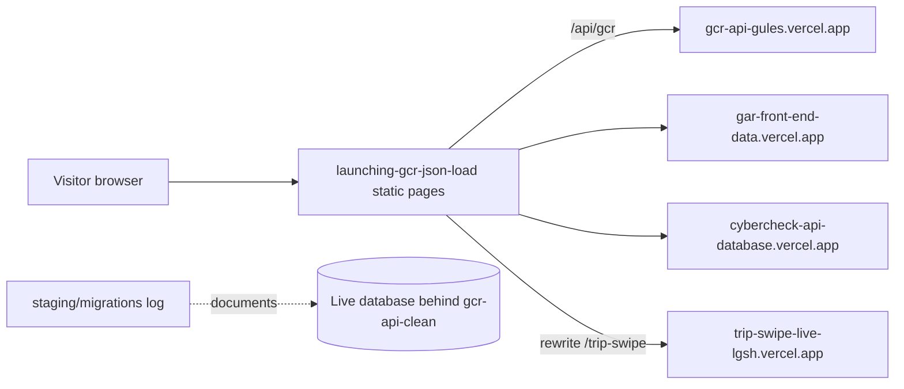

# launching-gcr-json-load

The public Gulf Coast Radar consumer website (static HTML pages) plus a written log of database migrations for the live platform database.

## What it is

A static site for a Gulf Coast local guide: restaurants, things to do, nightlife, happy hours, events, specials, deals, business profiles and search. It is the most recently updated GCR public front end (July 2026). It also carries planning notes (about 20 root-level `.md` files) and, under `staging/migrations/`, SQL files whose headers say they were applied to the live database.

## How it works

- About 40 top-level pages, e.g. `home.html`, `index.html`, `restaurants.html`, `things-to-do.html`, `search.html`, `profile.html`, `events.html`, `happy-hours.html`, `specials.html`, `deals.html`. Also `templates/` (profile templates), `profile types /`, `css/`, `logo/`.
- `js/`: `gcr-api.js` (API client), `gcr-listings.js`, `app.js`, `gcr-auth.js`, `gcr-saves.js`, `square-booking-modal.js`, `claim-modal.js`.
- `vercel.json`: no build step; `/` redirects to `/home`; `/trip-swipe/*` is rewritten to `https://trip-swipe-live-lgsh.vercel.app` (the `trip-swipe-` app). `_headers` sets caching.
- Data calls: `js/gcr-api.js` uses `https://gcr-api-gules.vercel.app/api/gcr` (`/entities`, `/entity/:id`, `/events`); other scripts call `https://gar-front-end-data.vercel.app` and `https://cybercheck-api-database.vercel.app`.
- `data/` and `clean-data.json` are static data snapshots; helper scripts `dedup-merge.js`, `audit.cjs`, `check-gaps.js`, `convert-happy-hours.js`, `upload-happy-hours.js`.
- `api-server.cjs`: a local Express dev server that reads `../tools/gcr-master-database.json`, which is not in this repo, so it does not start as committed.
- `staging/`: seed folders for four businesses (brick-and-spoon, ducks-diner, icehouse-tap-room, ruby-slipper-cafe) and `staging/migrations/001` to `008` (plus `MENU_REPAIR_STATUS.md`). The branch `claude/data-structure-impl-sg0g6w` adds `009_menu_pin_backfill.sql` and `010_display_template_config.sql`.

## Run it

```bash
npx serve .            # static pages; needs the external APIs above to be up
# deploys on Vercel with no build (vercel.json)
```

No env vars are used by the pages. `npm install` only pulls `express` and `cors` for the dev server, which cannot start without the missing data file. Not run as part of this review.

## Status

In use: the newest GCR public front end and the only written record of migrations 001 to 010 for the live database, though cluttered with notes and stale scripts.

## Where it fits



## Related repos

- `gulf-coast-radar-`: older March 2026 snapshot of the same front end (identical `data/api-businesses.json`); this repo supersedes it.
- `gcr-links`: older sibling in the same page family.
- `trip-swipe-`: proxied at `/trip-swipe`.
- `gcr-api-clean`: the live API whose database changes are logged in `staging/migrations/`.
